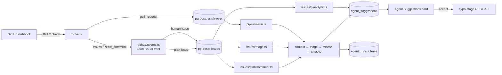

# HypoStage AI agents — Developer guide

This guide is for developers who want to understand, change or extend the AI agents module (`hypo-stage-backend-agents`, published as `@archhypo/plugin-hypo-stage-backend-agents`). For how each feature behaves from a user's point of view, see the [user guide](./user-guide.md).

## Contents

- [Architecture](#architecture)
- [Code map](#code-map)
- [Building blocks](#building-blocks)
- [Design rules](#design-rules)
- [Recipes](#recipes)
  1. [Add a suggestion kind](#1-add-a-suggestion-kind)
  2. [React to a new GitHub event](#2-react-to-a-new-github-event)
  3. [Add a recurring job](#3-add-a-recurring-job)
  4. [Use other Backstage plugins and services](#4-use-other-backstage-plugins-and-services)
  5. [Read a codebase beyond the PR diff](#5-read-a-codebase-beyond-the-pr-diff)
  6. [Tool calling and MCP](#6-tool-calling-and-mcp)
  7. [Add a model provider](#7-add-a-model-provider)
  8. [Add a frontend view](#8-add-a-frontend-view)
- [Testing](#testing)
- [Contribution checklist](#contribution-checklist)

---

## Architecture

### A module, not a plugin

The agents are a **Backstage backend module** of the `hypo-stage` plugin (`createBackendModule({ pluginId: 'hypo-stage', moduleId: 'agents' })` in `src/plugin.ts`). That gives it:

- the **same database** as the HypoStage backend plugin — it reads `hypothesis`, `technicalPlanning` and `hypothesisEvents` directly, and keeps its own tables (`agent_*`) with its own migration table (`knex_migrations_hypo_stage_agents`);
- the **same HTTP router** — its routes live under `/api/hypo-stage/...`.

Two consequences shape the code:

1. **It never writes the plugin's tables.** Agents create *suggestions*; when a user accepts one, the **frontend** applies it through the plugin's REST API (`useApplyAgentSuggestion`), so validation and the hypothesis history stay owned by the original plugin.
2. **Modules start before their plugin.** On a fresh database the plugin's tables don't exist yet, so `plugin.ts` runs the plugin's migrations (idempotent) before its own.

### Flow of a GitHub-triggered run



User-initiated features (coach, plan designer, opening plan issues) are synchronous HTTP routes; recurring work (coach fallback, coverage) runs on the Backstage scheduler.

---

## Code map

Backend (`hypo-stage-backend-agents/src`):

| Path | Responsibility |
|---|---|
| `plugin.ts` | Module registration: services, migrations, pg-boss, workers, scheduled jobs, routes, auth policy |
| `config.ts` / `../config.d.ts` | Reads and validates `hypoStage.*` config into `AgentsConfig` with defaults |
| `router.ts` | All HTTP routes: webhook, suggestions, runs, coach, planner, plan issues, coverage, report |
| `domain/archhypo.ts` | ArchHypo vocabulary (levels, statuses, action types, quality attributes) and record types |
| `providers/models.ts` | Model registry: config model key → AI SDK `LanguageModel` |
| `github/client.ts` | GitHub REST client (PRs, files, issues, comments, timeline, create/close issue) |
| `github/webhook.ts` | Signature verification and pull request event normalization/decisions |
| `github/events.ts` | Issue event routing: triage vs plan sync vs plan comment vs ignore |
| `queue/` | pg-boss setup (`boss.ts`) and job enqueueing/dispatch (`worker.ts`) |
| `pipeline/` | PR analysis: context loading, triage, assessment, checks, prompts, schemas, `generateStructured` |
| `coach/` | Hypothesis coach: review, schemas, prompts, checks, fallback job |
| `planner/` | Technical plan designer: strategy profiles, catalogue, prompts, checks |
| `issues/` | Issue triage, plan issues (create), plan sync, plan comments |
| `uncovered/` | Coverage job (uncovered themes) and findings listing |
| `reports/` | Issues report (JSON and Markdown) |
| `store/` | Data access for every `agent_*` table |
| `__testUtils__/` | Test fixtures (SQLite database, config, scripted models) |

Frontend (`hypo-stage/src`):

| Path | Responsibility |
|---|---|
| `api/HypoStageApi.ts` / `HypoStageMockApi.ts` | API client methods and types for every agent route; the mock (demo) disables agent features |
| `hooks/useAgentsStatus.ts` | Reads `/agents/health` to show or hide agent features |
| `hooks/useApplyAgentSuggestion.ts` | Applies accepted suggestions through the HypoStage API |
| `pages/HypothesisPage/components/AgentSuggestionsCard.tsx` | Suggestion review UI |
| `components/AgentRuns/`, `components/IssuesReport/` | Home page tabs |
| `components/coach/`, `components/planner/`, `components/planIssues/` | Coach panel, plan designer dialog, plan issue control |

---

## Building blocks

Reuse these rather than writing new plumbing.

### Models and structured output

```ts
import { createModelRegistry } from '../providers/models';
import { findModel } from '../config';
import { generateStructured } from '../pipeline/llm';

const modelDef = findModel(config, config.defaultModel!);
const result = await generateStructured({
  model: models.resolve(modelDef),
  schema: MyOutputSchema,          // zod schema
  system: MY_SYSTEM_PROMPT,
  prompt: buildMyPrompt(input),
  step: 'my-step',                 // name shown in the run trace
  trace: trace.steps,              // duration and token usage are appended
  timeoutMs: 30_000,               // optional (default 120 s)
  maxRetries: 0,                   // optional; 0 for user-facing calls
});
```

**Schema conventions** (see `pipeline/schemas.ts`): every key is required and optional values use `.nullable()`, never `.optional()`. This keeps schemas valid for OpenAI strict mode and easier for small local models. Use `.describe()` on fields — the descriptions reach the model.

`ARCHHYPO_PRIMER` in `pipeline/prompts.ts` explains ArchHypo concepts in a few lines; start new system prompts from it so every agent shares the same vocabulary.

### Checks (guardrails)

The model **proposes**, deterministic code **decides**. Every flow has a checks function (`pipeline/guardrails.ts`, `coach/guardrails.ts`, `planner/guardrails.ts`, `issues/guardrails.ts`) that:

- drops invented ids and values the HypoStage API would reject (enums, text limits, dates);
- enforces flow rules (e.g. *completes* only for merged PRs, reassessments only anchored on a planning);
- records **why** each proposal was dropped (`DroppedProposal`), which the Agent runs tab displays.

### Suggestions

`store/suggestions.ts`:

- `SuggestionKind`: `link`, `reassessment`, `planning_progress`, `new_planning`, `status_change`, `rewrite`, `evidence_alert`.
- `upsertPendingSuggestion(knex, { runId, source }, suggestion)` — idempotent insert: at most one pending suggestion per *(hypothesis, planning, kind)* (plus the URL for links, the evidence type for alerts, the status for status changes); new artifacts are appended to `sources`.
- `completedPlanningIds` / `isPlanningCompleted` — never propose completing a planning that was already completed.
- `supersedePending`, `supersedeFromSource` — withdraw outdated suggestions.

### Runs and traces

`store/runs.ts`: wrap each agent execution in `startRun({ ..., handler, origin, artifactKind })` and `finishRun(knex, runId, { status, trace })`. Push a step into `trace.steps` for every phase with `details` you want visible; the [Agent runs tab](./user-guide.md#agent-runs-tab) renders them. Add new handler names to `RunHandler` and to the frontend label map in `components/AgentRuns/AgentRunsTab.tsx`.

### Queues

`queue/worker.ts` uses pg-boss through the plugin's own database (`queue/boss.ts`):

- `singletonKey` deduplicates jobs (e.g. one PR analysis per commit);
- `startAfter` debounces (issue jobs wait `issues.debounceSeconds`, and later events in that window are dropped);
- retries with backoff; a failed run is recorded before rethrowing so pg-boss can retry.

pg-boss requires PostgreSQL; on SQLite the webhook answers 503 and only synchronous features work.

### Other helpers

- `pipeline/context.ts`: `loadHypotheses`/`loadOpenHypotheses` (hypotheses with plannings and recent events), `scopeHypotheses` (catalog scoping), `buildDiffDigest` (size-bounded diff).
- `github/events.ts`: `PLAN_MARKER_PATTERN`, `AUTOMATED_MARKER` for artifacts HypoStage writes.
- `store/dates.ts`: `toIso` normalizes timestamps from PostgreSQL and SQLite.

---

## Design rules

1. **Human in the loop.** Agents never change hypotheses or plannings directly; they create suggestions.
2. **Never write the plugin's tables.** Read them; change them only through the plugin's API from the frontend.
3. **No loops.** Only human-originated artifacts count as evidence. Artifacts HypoStage creates (plan issues, its own comments) carry a marker and only *sync* the plan they mirror. Each handler passes an explicit `allowedKinds` list to the checks.
4. **Deterministic first.** If something can be decided without the model (a closed issue, a `Fixes #N` link, a strategy from levels), decide it in code.
5. **Explainable.** Record dropped proposals and their reasons in the trace.
6. **Off by default.** New features get a config flag defaulting to `false`, exposed in `/agents/health` when the UI depends on it.
7. **Migrations are append-only.** Add a new file in `migrations/`; never edit one that may have run.

---

## Recipes

Each recipe lists the files to touch, a sketch based on existing code, and how to test it.

### 1. Add a suggestion kind

Example: `adr_link` — propose linking an architecture decision record.

1. **Backend kind** — add it to `SUGGESTION_KINDS` in `store/suggestions.ts`; if needed, add an identity rule in `suggestionIdentity`.
2. **Producer** — emit it from a checks function with a typed `payload`, and add it to the `allowedKinds` of the handlers that may produce it.
3. **Frontend type** — add a variant to the `AgentSuggestion` union in `api/HypoStageApi.ts`.
4. **Rendering** — label and details in `AgentSuggestionsCard.tsx` (`KIND_LABELS`, `SuggestionDetails`).
5. **Applying** — a `case` in `applyAgentSuggestion` (`hooks/useApplyAgentSuggestion.ts`) calling the existing HypoStage API; make it idempotent.
6. **Tests** — the checks test, `useApplyAgentSuggestion.test.ts`, `AgentSuggestionsCard.test.tsx`.

### 2. React to a new GitHub event

Example: analyze `release` events to summarize which hypotheses a release touched.

1. **Route** — in the webhook handler of `router.ts`, branch on `x-github-event` like `issues` does, verify the repository is configured, and enqueue a job.
2. **Job** — add a queue (or a new `handler` value on the issues queue) in `queue/worker.ts` with a `singletonKey`.
3. **Handler** — a new file (e.g. `releases/run.ts`) that calls `startRun({ handler: 'release_summary', ... })`, loads context, calls `generateStructured`, applies checks and stores suggestions with `upsertPendingSuggestion`.
4. **Webhook** — tell users to subscribe the event; document it in the user guide.
5. **Tests** — route test with a signed payload (see `router.test.ts`), handler test with `scriptedModel`.

### 3. Add a recurring job

Use the Backstage scheduler like the coach fallback and coverage jobs in `plugin.ts`:

```ts
if (config.digest.enabled) {
  await scheduler.scheduleTask({
    id: 'hypo-stage-agents-weekly-digest',
    frequency: { cron: '0 8 * * MON' },   // or { hours: 24 }
    timeout: { minutes: 10 },
    initialDelay: { minutes: 2 },
    scope: 'global',                       // one instance across replicas
    fn: async () => runWeeklyDigest({ knex, logger, config, models }),
  });
}
```

Ideas that fit ArchHypo:

- **Review digest** — hypotheses with high uncertainty and impact and no planning, plannings past their target date, pending suggestions older than N days.
- **Stale hypotheses** — no events or evidence for a long time; suggest re-evaluation.
- **Redundancy finder** — compare statements (embeddings from OpenAI/Google/Ollama; Anthropic has no embeddings API) and propose merges.

Keep jobs idempotent (store what was already processed, as the coach fallback does with `agent_hypothesis_reviews`) and bounded (`maxPerRun`).

### 4. Use other Backstage plugins and services

Declare dependencies in `plugin.ts` `deps` and pass them to your code:

| Service | Use for |
|---|---|
| `catalogServiceRef` (already used) | Richer context: component owners, systems, APIs, dependencies (`getEntitiesByRefs`, `getEntityByRef`); see `describeComponents` in `plugin.ts` |
| `coreServices.urlReader` | Read files from configured integrations (ADRs, TechDocs sources, `catalog-info.yaml`) using `readUrl` / `readTree` |
| Notifications (`notificationService` from `@backstage/plugin-notifications-node`) | Notify hypothesis owners about evidence alerts, fired triggers or completed plans |
| Permissions (`coreServices.permissions`) | Filter suggestions, runs and reports to what the viewer may see |
| Search (`@backstage/plugin-search-backend-node`) | Index hypotheses and suggestions, or find related documentation for prompts |
| `coreServices.auth` (already used) | Service credentials for calling other plugins |

Add the package to `package.json` dependencies, keep the feature behind a config flag, and degrade gracefully when the service is not installed (catch and log, as `describeComponents` does).

### 5. Read a codebase beyond the PR diff

PR analysis only sees the diff. To give agents more of the codebase:

- **GitHub API** — extend `github/client.ts` with `getContents(repo, path, ref)` (`GET /repos/{owner}/{repo}/contents/{path}`) or the trees API for directory listings.
- **`urlReader.readTree`** — fetch a directory (e.g. `docs/adr/`) through Backstage integrations, with caching and auth handled for you.
- **Bound the context** like `buildDiffDigest`: filter by file type, cap per file and in total using the model's `maxInputChars`, and record what was truncated in the trace.
- **Select before reading** — first ask the model (or a heuristic: changed paths, component boundaries) which files matter, then load only those. This keeps cost predictable and works with small models.

### 6. Tool calling and MCP

All flows today are fixed pipelines, which work with every model, including small local ones. Two ways to add more autonomy:

- **MCP as data access (recommended first)** — `@ai-sdk/mcp` (the release line matching AI SDK v6) provides `createMCPClient` with HTTP/SSE and stdio transports. Call its tools **from code** to fetch data (e.g. Jira tickets through an Atlassian MCP server) and pass the text to the existing pipeline. Keep an allow-list of read-only tools.
- **An optional tool-loop step** for capable models — give the model read-only tools (fetch a file, search issues) in an "investigate" step, enabled per model in config. Never expose write tools to the model; writes stay in code behind human approval.

Event-driven features still need webhooks or polling: MCP is pull-based.

### 7. Add a model provider

1. Install the AI SDK provider package matching AI SDK v6 (same `@ai-sdk/provider` major).
2. Add the name to `PROVIDERS` in `config.ts` and to the `provider` union in `config.d.ts`.
3. Add a `case` to `createProvider` in `providers/models.ts`.
4. Check that the provider supports structured output with `Output.object`; extend `providers/models.test.ts`.

### 8. Add a frontend view

1. Add the route in `router.ts` (authenticate with `httpAuth.credentials`).
2. Add the method and types to `HypoStageApi.ts`, and a stub to `HypoStageMockApi.ts` (the demo must keep working without agents).
3. Expose a flag in `/agents/health` and read it with `useAgentsStatus`, so the UI hides the view when the feature is off.
4. Follow the existing patterns: a card on the hypothesis page (`AgentSuggestionsCard`), a dialog (`PlanDesignerDialog`), or a home page tab (`HomePage.tsx` + `components/AgentRuns`).

---

## Testing

Backend (`hypo-stage-backend-agents`, `yarn backstage-cli package test`):

- `__testUtils__/fixtures.ts`:
  - `createTestDatabase()` — in-memory SQLite with the HypoStage plugin migrations and the agents migrations;
  - `testConfig(overrides)` — a complete `AgentsConfig`;
  - `insertHypothesis`, `insertPlanning`, `issueDetails` — data builders;
  - `scriptedModel((system, prompt) => output)` — a `MockLanguageModelV3` that answers each call with a JSON object chosen from the system prompt.
- Router tests use `supertest` with `mockServices.httpAuth` and `mockCredentials` from `@backstage/backend-test-utils`.
- `plugin.test.ts` boots the module with `startTestBackend`.

Frontend (`hypo-stage`): components are tested with `renderInTestApp` and `TestApiProvider`, mocking only the API methods the component calls.

Before opening a PR, run `make check` (build, tests and lint for every workspace).

---

## Contribution checklist

- [ ] Config keys in `config.d.ts` and `readAgentsConfig`, **off by default**, exposed in `/agents/health` if the UI needs them
- [ ] A new migration for new tables or columns (never edit existing ones)
- [ ] Model output goes through checks; dropped proposals record a reason
- [ ] Runs recorded with `startRun`/`finishRun` and meaningful trace steps
- [ ] Suggestions stored with `upsertPendingSuggestion` and a correct `allowedKinds` list
- [ ] No writes to the HypoStage plugin's tables; no loops through artifacts HypoStage creates
- [ ] Tests for checks, handler and routes; frontend tests for new UI
- [ ] A section in the [user guide](./user-guide.md) (what it does, set up, try it, outcomes, when nothing happens)
- [ ] `make check` passes
